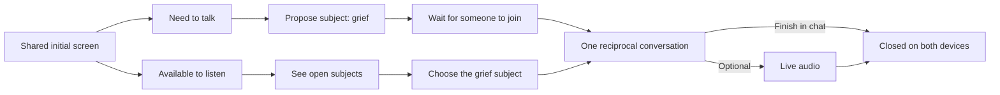

# Subject-led entry — selected demo direction

**Updated:** 24 October 2026  
**Scope:** The owner selected option A after reviewing the clickable entry mockup (intake A-32). The initial screen presents two intentions (A-30): a person needing to talk opens a subject and waits, while someone available to listen sees open subjects and chooses one (A-31). This selects the demo's UX direction, not a public matching feature.

## PO assessment

This gives each initial intention a clear next action and grounds the conversation in a subject. It also makes the meeting point understandable: **one person opens an exchange around a topic; another chooses to join it**. After that moment, both have equal ability to write and respond; an audio call is available but optional (A-28, A-32; D-R1 to D-R2). The initial distinction is about **how the exchange begins**, not who is allowed to speak.

For the hackathon demo, keep the experiment to **one fictional open subject, grief**, and two known devices (A-8, A-12, A-13, A-22, A-23, A-26). A list that shows one local example can test whether the flow is understandable. It does not establish public discovery, automatic matching, availability management, moderation or a real service. Those would need separate product decisions and a scoped PRD. The revised [initial PRD](../../prds/entre-nous-initial.md) still treats automatic matching as outside the confirmed demo.

## Initial-screen hierarchy to try

| Layer | Candidate content (**Hypothesis**) | Purpose |
| --- | --- | --- |
| 1. Short promise | « Parler ou écouter, le temps d'une conversation » | Explain a temporary, reciprocal exchange without permanent labels or a clinical promise. |
| 2. Two equal actions | « J'ai besoin de parler » and « Je suis disponible pour écouter » | Let the person choose how they enter, with neither action visually treated as secondary. |
| 3. What follows | « Proposez un sujet ou rejoignez un échange en attente. Ensuite, chacun peut écrire et répondre librement. » | Make the two paths and their convergence clear before a click. |
| 4. Demo context | « Conversation fictive » | Prevent the hackathon screen from implying that real support seekers are present. |

These are copy and layout hypotheses. The chosen visual direction remains **warm and human** (A-25); color, type and exact wording are still open.

## Two paths that converge

| Moment | Person who needs to talk | Person available to listen | Shared boundary |
| --- | --- | --- | --- |
| Initial screen | Selects « J'ai besoin de parler ». | Selects « Je suis disponible pour écouter ». | These are entry intentions, not persistent role permissions. |
| Subject | Proposes a broad subject; the demo example is « Deuil ». | Sees a list of open subjects; the demo shows that one fictional subject. | **Hypothesis:** the list exposes the topic only; personal details belong inside the conversation. |
| Before joining | Sees that the subject is open and waits for someone to join. | Chooses the subject and joins. | Waiting, empty-list and cancellation behaviour need review. |
| Active exchange | Can write and answer as often as needed. | Can write and answer as often as needed. | One reciprocal chat; either person may choose an optional real audio call (D-R1, D-R2; A-28, A-32). |
| End | Sees the conversation close. | Sees the conversation close. | Ending the written chat or the optional call clears both views and prevents session resumption (D-R3; A-32). |

## Questions exposed by this flow

1. **Subject versus story:** Does “propose a subject” mean a broad category such as « Deuil », a free-text title, or a short description? The mockup starts with an editable « Deuil » example. For any real-person service, exposing personal details in an open list would require a separate privacy and safety decision.
2. **Waiting:** What does the person who opened the subject see while nobody has joined? Can they edit or cancel? How long does it remain open? These behaviours are `Not provided.`
3. **Choosing:** What does the listener need to know before joining? The demo can show one fictional subject without claiming a validated matching or ranking rule.
4. **Connection:** If two people choose the same subject, or a second listener tries to join, what happens? The two-person demo does not settle multi-user rules.
5. **Closure:** Does the subject disappear from the open list immediately when joined and stay unavailable whether chat or a call ends? This is the candidate UX to test; server behaviour remains unimplemented.

## Rapid experiment

The [local clickable mockup](entry-flow-lab.html) lets one panel open a fictional subject, wait, and the other panel find and join it. The same symmetric chat follows, with two ending routes: finish in written chat or take the simulated optional call and end it. The owner selected this entry direction after reviewing it (A-32). The [entry-flow experiment](entry-flow-experiment.md) remains a record of the alternatives, not evidence of participant usability. Observe whether a person can explain **what each initial action leads to**, find the open subject without coaching, and still understand that both can participate equally after joining.

**Status:** Entry structure and optional voice selected by the owner (A-32); exact copy and interaction details remain hypotheses. **NOT RUN:** external participant observation; no real two-device chat, live audio, public subject list, privacy or safety validation. The [feature F-D-01](../../features/demo-fictional-exchange-chat.md) and revised PRD carry the demo requirement detail.
