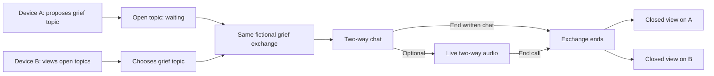

# User flows — fictional demo

**Updated:** 24 October 2026  
**Scope:** A fast, source-grounded flow map for the two fictional participants on separate devices on one LAN. The [experience context](experience-context.md) gives the visual and verbal direction. These flows are design hypotheses where the sources do not specify an interaction; they do not represent observed behaviour from user research.

## Structure and sources

The document follows the owner's [AnimeSphere UX Discovery — Parcours & MVP](https://app.notion.com/p/1bb32705124c8088be5add1868c85c60) **as a structure reference**: entry, goal, steps, exit/action, screens, success signal and friction for each path (intake A-27). No AnimeSphere persona, route, metric or interface choice is imported into “Entre nous”. Product evidence comes from [intake A-1 to A-13 and A-22 to A-32](../product-context/intake/espaces-ecoute-ephemeres.md), the [initial PRD revision](../../prds/entre-nous-initial.md) D-R1 to D-R4 and [demo features](../../features/README.md). The [conversation UX options](conversation-ux-options.md) address the owner's explicit reciprocity correction (A-28).

**Flow outcome:** show one fictional grief conversation in which both participants can write, receive, reply and continue over several turns. They may finish in written chat or choose a live audio call; either route reaches the same closed state (A-32). The owner selected the [subject-led entry](subject-entry-flow.md): one person opens a subject and waits, and another chooses that open subject (A-30 to A-32). The entry perspectives do not define messaging permissions or a fixed turn order (A-28).

## Flow A — “I need to talk”

| Element | Demo path |
| --- | --- |
| Actor and goal | Fictional person who needs to speak about grief; show how an exchange starts (A-1 to A-4, A-26). |
| Entry | **Owner-selected direction (A-30 to A-32):** choose « J'ai besoin de parler » on the shared initial screen. Exact copy and connection mechanics remain `Not provided.` |
| Steps | 1. Propose the fictional grief subject. 2. See that the subject is open and wait for someone to join. 3. Enter the shared exchange. 4. Write a message. 5. Read the other person's reply and respond or ask a question in turn. 6. Continue writing, or choose a live audio call. 7. End the chat directly or end the optional call. 8. See the closed state. |
| Exit and action | The previous thread is absent from the participant view; the same session cannot be resumed or used to contact the listener (D-R3). |
| Candidate screens/states | Entry → conversation → closed, with an optional call between conversation and closure. These are the [candidate screens](experience-context.md#candidate-screen-structure), not approved layouts. |
| Success evidence | On device A, the participant can send, receive and reply across multiple turns, finish without voice, and see that the session closes; a separate call-path check verifies live audio (D-R1 to D-R3; A-28, A-32). |
| Friction or open branch | Subject format, waiting and cancellation rules, exact grief script, join step, call invitation, microphone permission and unexpected disconnect are `Not provided.` |

## Flow B — “I can listen”

| Element | Demo path |
| --- | --- |
| Actor and goal | Fictional citizen available to listen and participate in the same grief exchange (A-2 to A-4, A-26, A-28). This is a position in the demo, not a permanent profile or a restriction on writing. |
| Entry | **Owner-selected direction (A-30 to A-32):** choose « Je suis disponible pour écouter » on the shared initial screen. Exact copy and connection mechanics remain `Not provided.` |
| Steps | 1. See a list of open fictional subjects. 2. Choose the grief subject and join. 3. Read the other person's message. 4. Write a reply and continue with a question, thought or lived experience as the exchange allows. 5. Read and respond to the next message. 6. Continue in written chat or take part in the optional live audio call. 7. End the chat or call and see the closed state. |
| Exit and action | The previous thread is absent from the participant view; the same session cannot be resumed or used to contact the speaker (D-R3). |
| Candidate screens/states | Entry → conversation → closed, with an optional call, shared with Flow A. |
| Success evidence | On device B, the participant can receive, send and reply across multiple turns, finish without voice, and see that the session closes; a separate call-path check verifies live audio (D-R1 to D-R3; A-28, A-32). |
| Friction or open branch | Empty-list behaviour, visible subject details, precise response and advice in the fictional script, join step, call acceptance, microphone permission and unexpected disconnect are `Not provided.` |

## Shared flow and convergence

The two selected entry paths converge when the second person chooses the open subject. Both participants then have the same message capabilities; the chat can alternate in either direction without a prescribed turn order (A-28). Voice is optional, and closure from either path is propagated to **both** participants (A-32). D-R4's fictional sample content and no-history boundary apply throughout. The sketch shows product states, not a selected protocol or system architecture.

| Transition | Participant-visible outcome | Source | Open design detail |
| --- | --- | --- | --- |
| Entry → exchange | One opens a grief subject and waits; the other selects it. Both then reach the same conversation and can write and reply freely. | D-R1; A-28, A-30 to A-32 | Subject format, waiting and joining rules. |
| Chat → call (optional) | The same pair can choose to hear each other live. | D-R2; A-10, A-13, A-32 | Who initiates, how the other accepts, permission and failure feedback. |
| Chat or call → closed | Ending the written chat directly or ending the optional call removes the exchange from both participant views and prevents session resumption. | D-R3; A-5, A-10, A-13, A-32 | Exact end action, closed-state copy, unexpected disconnection. |
| Across all states | Fictional sample content is used without a stored conversation history. | D-R4; A-8, A-12 | Actual storage and log inspection is pending. |

## Minimum review for this rapid pass

1. Walk through Flow A and Flow B side by side on paper or in a low-fidelity wireframe; check that each action has a visible response on the other device.
2. Choose the exact fictional grief script and entry labels. Show more than one message from each person; check that replies stay informal and fit the expressed preference (A-3, A-4, A-28).
3. Decide the join, optional call invitation and unexpected-disconnect branches before detailed screen design; keep these decisions traceable to the flow.
4. Run both the chat-only and optional-call paths on the actual two devices and inspect both closed views, the resumption attempt, and the message data path. These are future implementation checks, not completed validation.

The [two-minute video](../../prds/entre-nous-initial.md) follows the same story after its in-person opening (D-R5); its storyboard and timing are a separate review. Real participants, public matching, accounts, moderation and later administrator archives remain outside these demo flows.

## Verification record

Read the AnimeSphere reference page's text on 24 October 2026. Its fetch was marked truncated and contained an inaccessible external-object block under “Maquettes UX”; the user-flow sections used for this structure were visible. Checked the current PRD, features, product context and cited intake answers. **NOT RUN:** wireframe walkthrough, two-device journey, audio, resumption, storage inspection or usability research. The owner requested a fast documentation pass without extensive UX research (A-27).
