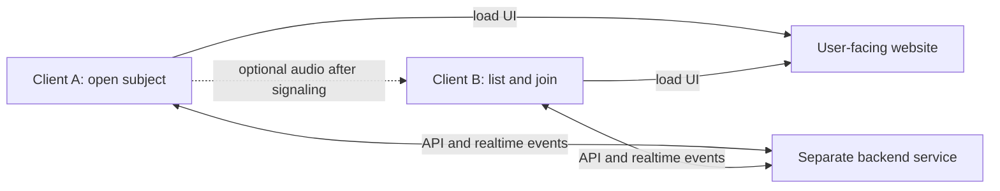

# Technical context — short-lived listening between citizens

Date: 2026-10-24
Functional sources: `docs/context/product-context/discovery/entre-nous-product-discovery.md`, `docs/context/product-context/briefs/espaces-ecoute-ephemeres.md`, and `docs/context/product-context/intake/espaces-ecoute-ephemeres.md` (especially A-20 to A-23 for frontend/backend, skill order and two-device LAN scope; A-30 to A-34 for subject-led entry, optional voice, server-held sessions and a separate backend service). These are living context and cited user decisions, not approval gates.
PRD: The [initial product PRD](../../prds/entre-nous-initial.md) had an approved baseline and now has an A-32 revision ready for review, with reviewable demo features; it is not an accepted scoped implementation PRD.
Implementation readiness: The web demo scope, Nuxt preference, frontend/backend direction and two-device LAN requirement are known. A scoped PRD, secure LAN access, audio verification and the infrastructure ADR's material choices remain to resolve before claiming a build baseline.

## Delivery scope

The user chooses the **hackathon demonstration** as the immediate architecture target and accepts a later redesign (A-18). They select a **web application** and prefer Vue/Nuxt (A-19). In the 24 October 2026 engineering-context request, they add a **frontend and backend** and ask for a lightweight backend language suited to their skills. Their follow-up ranks skills **.NET, Python, TypeScript/Node, Java, PHP** and requires the two fictional participants to use **distinct devices on the same LAN**. Their goal is to win the event; this is an aspiration, not a predicted result. The deliverable remains a local fictional demonstration with sample messages, two-way chat, an optional real audio-call capability, and an end from chat or call that removes the exchange from both participant views (A-8, A-10, A-12, A-13, A-32). The existing web prototype is exploratory, not the selected target architecture (A-14).

A possible later service would connect real adults in France. Its safety, identity, moderation, archive, emergency, and operational rules remain open or deferred (A-5, A-7, A-11; [product context](../product-context/product-context.md)). This document does not define that service as ready to implement.

## Required capabilities and quality concerns

| Need | Source | Technical implication | State |
| --- | --- | --- | --- |
| Two fictional participants exchange messages and may choose audio using distinct devices on one LAN. | A-12, A-13, A-32; owner's 24 October 2026 answers | The demo needs a backend-accessible session, a two-party message channel and optional WebRTC call signaling. LAN connectivity still needs testing. | Confirmed demo need; target implementation pending. |
| One client opens a subject session; another sees open subjects and joins one. The session belongs on a server reachable by both clients. | A-30 to A-33 | Keep the open-subject view, temporary session membership and two-client limit coordinated by the server; both clients receive the same state changes. | User-stated architecture boundary; exact protocol and host are not selected. |
| Participants enter through a simple website URL; the web app obtains and sends session data through a distinct backend service. | A-20, A-34 | Separate the user-facing frontend from the session API/realtime service. The backend is the shared source for active topics and sessions; a browser's local state is only its current view. | User-stated service boundary; physical host and public URL choices are not selected. |
| Ending chat directly or ending an optional call closes the participant exchange. | A-5, A-10, A-13, A-32 | Both participant views must clear the session and stop any active audio; future administrator retention is a separate concern. | Confirmed demo behaviour; future retention undecided. |
| Participant identities are concealed from each other to reduce fear of judgment. | A-1, BR-3 | What the operator knows and how a real service establishes identity remain undefined. | Not decided. |
| The hackathon demo should make the first exchange understandable in a two-minute pitch. | A-9, A-11, A-18; [kickoff](../hackathon-kickoff.md) | The technical journey should support a repeatable, easy-to-film sequence; presentation quality and actual reliability need verification. | Confirmed priority; implementation acceptance pending. |
| The hackathon application is web based, with a Vue/Nuxt preference. | A-19 | Choose a browser-oriented implementation and assess whether a Nuxt migration is worth the remaining demo time. | Web selected; framework preference expressed; implementation pending. |
| The solution has a frontend and backend, with a backend language matching the owner's skills. | Owner's 24 October 2026 request and follow-up | Compare backend choices with .NET as the strongest skill, then Python and TypeScript/Node. | Backend requested; language and framework proposed below, not selected. |
| A later real service might use a mobile app. | A-17, A-18 | Defer platform, tooling, installation, and device support decisions until the later service is scoped. | Hypothesis. |
| Real-person exchanges could involve reports, retained history, and urgent distress. | A-4, A-5, A-11 | Data boundaries, authorized access, moderation operations, and escalation require product and specialist decisions before design. | Deferred; not part of the demo. |

## Observed systems

- `prototype/server.js` serves static files on `127.0.0.1`. This is a local demo server, not an application backend. Loopback binding makes it reachable only from the host device, so this observed process cannot serve the selected two-device LAN journey as-is.
- `prototype/app.js` uses `BroadcastChannel` for same-browser tabs and `RTCPeerConnection` with microphone access for audio. It clears in-memory messages, closes the peer connection, and stops microphone tracks when the session ends.
- `prototype/index.html` declares a mobile viewport, and `prototype/styles.css` contains layouts for narrower screens. This is observed responsive styling; device compatibility has not been tested.
- `prototype/README.md` records no accounts, database, remote API, or persistent conversation storage. The two tabs must run on the same device. **This cannot satisfy the owner's new two-device requirement.** These observations do not prove production privacy or deletion behaviour.
- The active `prototype/` has no Nuxt project or cloud deployment configuration. A Nuxt application would be a new implementation or migration, not a description of the current prototype.
- The initial product PRD's baseline was approved, and its A-32 revision awaits review; no accepted scoped implementation PRD, deployed service, mobile client, or selected target architecture is present.

## Candidate architecture and boundaries

**Separate frontend and backend from the owner (A-33, A-34).** Both people open the user-facing website through a simple URL. That web app calls a distinct backend service for the open-subject list, subject creation, joining and realtime exchange. The backend owns the authoritative open-subject/session state, admits the second client to an available two-person session, relays chat and publishes closure to both. A subject is the human-readable reason for joining; a distinct temporary session identifier is a design hypothesis so two exchanges with the same subject would not collide. The backend must reject a third join or a join after closure; the exact race, expiry and reconnect rules are `Not provided.` “Back-office” is an analogy for the separate service, not a selected administrator interface.

For this hackathon's **same-LAN** requirement, both frontend and backend need endpoints reachable from the two devices. They are separate services; they may run on one LAN machine as different processes or on different machines. A second physical host, cloud deployment and a public Internet address do not follow automatically from A-34. Exact hostnames, ports, origins and routing remain implementation choices. If the demo must be reachable from other networks later, its hosting and network path need a new decision. Optional WebRTC audio may flow between browsers after the backend relays signaling; whether a media relay is needed cannot be assumed before the two-device test.

**Web demo implementation.** The user has selected web, prefers Vue/Nuxt, and now requests a backend and two-device interaction. The [revised proposed infrastructure ADR](../../adr/0001-web-demo-infrastructure.md) compares these choices:

| Candidate | Fit to demo need | Tradeoffs and evidence gap |
| --- | --- | --- |
| Nuxt frontend + small ASP.NET Core/SignalR backend | Aligns with Vue/Nuxt preference, the owner's strongest backend skill (.NET), and two-device chat/signaling need. [SignalR supports browser clients and groups](https://learn.microsoft.com/en-us/aspnet/core/signalr/introduction). | Two running components, secure browser origins, connection lifecycle and a tested WebRTC media path. |
| Nuxt frontend + Python/FastAPI backend | Aligns with the owner's second strongest skill; [FastAPI supports WebSockets](https://fastapi.tiangolo.com/advanced/websockets/). | A manually specified realtime protocol; the same browser and LAN verification is needed. |
| Nuxt frontend + separate TypeScript/Node backend | Shares the frontend language while preserving the selected service boundary. | Owner ranks this language third; the chosen runtime's realtime support and host must be verified. |

**Architect's provisional recommendation:** Serve a Nuxt user-facing site and a separate small ASP.NET Core backend with SignalR for temporary session membership, chat, WebRTC signaling and closure. Keep scripted examples explicit and avoid a persisted conversation history for the demo. This uses the owner's strongest backend skill and serves two devices. The architecture remains `PROPOSED` in its ADR. Keep the existing prototype as a reference for the journey, but its same-browser implementation is no longer a functional fallback for the two-device requirement.

**Proposed interaction contract, to refine in the scoped PRD:**

| Step | Browser responsibility | Backend responsibility | Data lifetime hypothesis |
| --- | --- | --- | --- |
| Open a fictional subject | Send the subject from client A and display a waiting state. | Create one temporary session with an open subject and one member; publish it to eligible clients. | Subject and membership are temporary; no conversation archive. |
| See and join an open subject | Client B displays the open list and selects one subject. | Return open sessions and atomically admit one second client to an available session; remove it from the open list. | Two-member session state until closure or expiry. |
| Exchange messages | Display and send fictional chat messages. | Relay to the other participant. | Visible messages in browser memory; no conversation archive. |
| Start an optional audio call | Request microphone permission only if voice is chosen, then exchange WebRTC setup data. | Relay offers, answers and ICE candidates; do not carry audio. | Signaling only for the active call. |
| End chat, end call or disconnect | Stop any active microphone tracks, close any peer connection and clear the participant view. | Notify the other device and release temporary session state under a defined closure/disconnect rule. | No participant access after either intentional closure; server expiry still to define. |

This contract translates the user's selected subject-led flow and server-held session model into a **proposed technical contract** (A-30 to A-33). The subject and two-client session are user direction; a separate session identifier, atomic admission and event design are architecture hypotheses. Event names, retries, reconnect behaviour and timeouts are `Not provided.` They must be specified and tested before implementation is treated as complete.

**Runtime boundary.** The frontend serves the pages and runs the interface in each browser. The browsers keep the visible fictional messages during a session and own their microphone tracks only if a call is chosen. The separate backend would own the authoritative open-subject list and temporary session membership, relay chat, closure and optional audio signaling. It need not carry the audio stream in the proposed WebRTC design. The demo's “no stored conversation history” (A-12) means the backend may hold active session state only temporarily; adding a persistent database or an administrator back-office is not implied by A-34. The final state lifecycle, server logs, and disconnect behaviour need specification. Microphone access requires a secure context such as localhost or HTTPS and user permission ([MDN](https://developer.mozilla.org/en-US/docs/Web/API/MediaDevices/getUserMedia)); `localhost` on device B refers to device B, and a plain local IP URL for the server is not automatically a secure context.

**Interaction boundary.** The prototype's `BroadcastChannel` connects same-origin browsing contexts, not the two devices now required ([MDN](https://developer.mozilla.org/en-US/docs/Web/API/Broadcast_Channel_API)). The proposed SignalR channel would relay chat and WebRTC offers, answers and ICE candidates; WebRTC would carry audio between browsers if connectivity succeeds ([MDN](https://developer.mozilla.org/en-US/docs/Web/API/WebRTC_API/Signaling_and_video_calling)). The owner specifies one LAN. A secure origin, LAN reachability and actual peer connectivity must be tested; do not assume the LAN eliminates all ICE or relay issues.

**Data boundary.** The demo has no conversation archive (A-12). An in-memory backend is a hypothesis; messages should be relayed without persistence, and session state removed after closure or an agreed disconnect timeout. Server request/error logging must be checked so the no-storage claim is accurate. A future service is expected to hide closed conversations from participants while retaining some history for administrators (A-5), but its purpose, access, duration, and legal basis remain undecided (A-11; [preliminary research](../product-context/research/securite-confidentialite-ecoute-citoyenne.md)). No database is selected here.

## Constraints and unknowns

- The hackathon submission requires a two-minute pitch video by 25 October 2026 before midnight Paris time ([kickoff](../hackathon-kickoff.md)); this is an event constraint, not a production architecture requirement.
- The first real-person audience is intended to be adults in France (A-7), but the real-user scope and safeguards remain undefined.
- The immediate architecture scope is the web hackathon demo (A-18, A-19), on two distinct devices on one LAN with a user-facing site and separate reachable backend service (A-22, A-23, A-33, A-34). Not provided: which LAN machine or machines host them, their origin/routing plan, whether a public project link is desired, exact devices/browsers, offline expectations, accessibility needs, expected scale, budget, and team capacity.
- Not provided: exact identity rules, moderation workflow, archive policy, emergency response, and accepted quality targets. These materially affect any future real-service architecture.

## Decisions and ADRs

**User decisions/direction:** Prioritize the hackathon demonstration now, allow a later redesign (A-18), use web with a Vue/Nuxt preference (A-19), support two distinct LAN devices (A-20 to A-23), and provide a user-facing site plus a separate backend service that coordinates subject sessions (A-33, A-34). The [web demo infrastructure ADR](../../adr/0001-web-demo-infrastructure.md) is `PROPOSED`; it recommends Nuxt plus ASP.NET Core/SignalR and no conversation database for the fictional demo. The user has confirmed the service boundary, not that exact stack or physical hosting topology. A later real-service architecture remains separate.

## Handoff to later agents

Later agents may rely on the selected web demo direction, the two-device LAN requirement, the user-facing website plus separate backend service and server-held subject session boundary (A-33, A-34), the owner's backend skill order and the observed prototype facts above. They must treat ASP.NET Core/SignalR, Nuxt rendering mode, the LAN host/origin topology and WebRTC connectivity plan as provisional. The current prototype is a reference for the fictional journey, not a two-device fallback. The next review should establish reachable secure access to both services from both devices, test opening/listing/joining one session, verify chat, audio and both closure routes, and make the two-minute filmed explanation repeatable. Use a scoped PRD for implementation planning and revisit this living context as decisions and test evidence arrive.

## Verification record

- Inspected `prototype/README.md`, `prototype/server.js`, `prototype/app.js`, `prototype/index.html`, and `prototype/styles.css` for the local demonstration facts above.
- Read the owner's 24 October 2026 engineering request and follow-up answers for backend skill ranking and distinct-device scope; reviewed [Nuxt server API](https://nuxt.com/docs/guide/concepts/server-engine), [SignalR](https://learn.microsoft.com/en-us/aspnet/core/signalr/introduction), [FastAPI WebSockets](https://fastapi.tiangolo.com/advanced/websockets/), and [WebRTC signaling](https://developer.mozilla.org/en-US/docs/Web/API/WebRTC_API/Signaling_and_video_calling) documentation for candidate capabilities.
- NOT RUN: two-device chat or audio, secure-origin setup, network traversal, device compatibility, production privacy/security, or performance checks; the proposed target has not been implemented.
