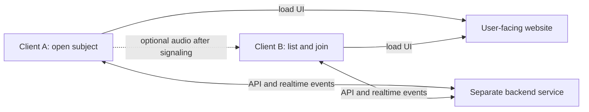

# Technical context — short-lived listening between citizens

Date: 2026-10-25
Functional sources: `docs/context/product-context/discovery/entre-nous-product-discovery.md`, `docs/context/product-context/briefs/espaces-ecoute-ephemeres.md`, and `docs/context/product-context/intake/espaces-ecoute-ephemeres.md` (especially A-20 to A-23 for frontend/backend, skill order and two-device LAN scope; A-30 to A-36 for subject-led entry, optional voice, server-held sessions and a separate backend service). These are living context and cited user decisions, not approval gates.
PRD: The [initial product PRD](../../prds/entre-nous-initial.md), its current A-32 to A-36 revision, the three demo features, and both [lot 1](../../prds/build-in-public-video-lot-1.md) and [lot 2](../../prds/interactive-session-mvp.md) scoped PRDs are approved following the owner's explicit 25 October 2026 decisions (A-40 for the scoped PRDs).
Implementation readiness: ADR 0001 is approved for the fictional demo architecture. The scoped PRDs are approved; detailed protocol and disconnect rules, secure LAN access, audio verification and executable checks remain before claiming a build baseline.

## Current implementation evidence — 25 October 2026

The selected Nuxt frontend, ASP.NET Core 10/SignalR backend, Compose packaging and Caddy HTTPS gateway now exist. Explicit subject creation/choice, reciprocal chat, A-42 optional audio invitation flow, opener closure and joiner departure are implemented. Backend build, formatting and five SignalR integration tests pass; frontend type/build/format checks pass. Compose and three isolated Chromium contexts also passed the chat and synthetic-media lifecycle smoke checks; certificate trust was bypassed in automation. See the [implementation contract](implementation-contract.md), [runbook](../../local-demo-runbook.md) and individual plan progress. Physical two-phone trust and audible audio remain **NOT RUN**; unexpected-disconnect expiry and recovery remain undecided. Earlier implementation-pending descriptions below preserve the architecture baseline and must not be read as current code inventory.

## Delivery scope

The user chooses the **hackathon demonstration** as the immediate architecture target and accepts a later redesign (A-18). They select a **web application** and prefer Vue/Nuxt (A-19). In the 24 October 2026 engineering-context request, they add a **frontend and backend** and ask for a lightweight backend language suited to their skills. Their follow-up ranks skills **.NET, Python, TypeScript/Node, Java, PHP** and requires the two fictional participants to use **distinct devices on the same LAN**. Their goal is to win the event; this is an aspiration, not a predicted result. The deliverable remains a local fictional demonstration with sample messages, two-way chat, an optional real audio-call capability, and opener-controlled closure from chat or call that removes the exchange from both participant views (A-8, A-10, A-12, A-13, A-32, A-35). The existing web prototype is exploratory, not the selected target architecture (A-14).

A possible later service would connect real adults in France. Its safety, identity, moderation, archive, emergency, and operational rules remain open or deferred (A-5, A-7, A-11; [product context](../product-context/product-context.md)). This document does not define that service as ready to implement.

## Required capabilities and quality concerns

| Need | Source | Technical implication | State |
| --- | --- | --- | --- |
| Two fictional participants exchange messages and may choose audio using distinct devices on one LAN. | A-12, A-13, A-32; owner's 24 October 2026 answers | The demo needs a backend-accessible session, a two-party message channel and optional WebRTC call signaling. LAN connectivity still needs testing. | Confirmed demo need; target implementation pending. |
| One client opens a subject session; another sees open subjects and joins one. The session belongs on a server reachable by both clients. | A-30 to A-35; ADR 0001 | Keep the open-subject view, temporary session membership and two-client limit coordinated by the server; both clients receive the same state changes. | User-stated boundary and approved architecture direction; detailed protocol pending. |
| Participants enter through a simple website URL; the web app obtains and sends session data through a distinct backend service. | A-20, A-34, A-35 | Separate the user-facing frontend from the session API/realtime service. The backend is the shared source for active topics and sessions; a browser's local state is only its current view. | Service boundary and owner's PC as local host selected; routing and any public URL open. |
| The opener can cancel while waiting or explicitly end from chat or call; joiner exit clears the current exchange and returns the opener to waiting; hangup returns both to chat. | A-35, A-36 | Backend must distinguish subject closure, joiner exit and call hangup. Old messages must not reach a new joiner. | Intentional transitions confirmed; unexpected disconnect open. |
| The owner will run the local server on their PC, validate containerized services from that PC, then connect two phones on the LAN. | A-35; ADR 0001 | Run distinct frontend and backend containers with Compose on the PC; use two PC browser clients for the first functional test, then validate the trusted LAN URL and audio on both phones. | Hosting direction approved; container configuration and secure phone access pending. |
| Participant identities are concealed from each other to reduce fear of judgment. | A-1, BR-3 | What the operator knows and how a real service establishes identity remain undefined. | Not decided. |
| The hackathon demo should make the first exchange understandable in a two-minute pitch. | A-9, A-11, A-18; [kickoff](../hackathon-kickoff.md) | The technical journey should support a repeatable, easy-to-film sequence; presentation quality and actual reliability need verification. | Confirmed priority; implementation acceptance pending. |
| The hackathon application is web based, with a Vue/Nuxt preference. | A-19; ADR 0001 | Implement the approved Nuxt frontend for the demo; choose exact version and rendering mode during implementation. | Web and framework direction selected; implementation pending. |
| The solution has a frontend and backend, with a backend language matching the owner's skills. | Owner's 24 October 2026 request and follow-up; ADR 0001 | Use the approved Nuxt and ASP.NET Core/SignalR direction for the demo. | Architecture selected; exact versions and implementation pending. |
| A later real service might use a mobile app. | A-17, A-18 | Defer platform, tooling, installation, and device support decisions until the later service is scoped. | Hypothesis. |
| Real-person exchanges could involve reports, retained history, and urgent distress. | A-4, A-5, A-11 | Data boundaries, authorized access, moderation operations, and escalation require product and specialist decisions before design. | Deferred; not part of the demo. |

## Observed systems

- `prototype/server.js` serves static files on `127.0.0.1`. This is a local demo server, not an application backend. Loopback binding makes it reachable only from the host device, so this observed process cannot serve the selected two-device LAN journey as-is.
- `prototype/app.js` uses `BroadcastChannel` for same-browser tabs and `RTCPeerConnection` with microphone access for audio. It clears in-memory messages, closes the peer connection, and stops microphone tracks when the session ends.
- `prototype/index.html` declares a mobile viewport, and `prototype/styles.css` contains layouts for narrower screens. This is observed responsive styling; device compatibility has not been tested.
- `prototype/README.md` records no accounts, database, remote API, or persistent conversation storage. The two tabs must run on the same device. **This cannot satisfy the owner's new two-device requirement.** These observations do not prove production privacy or deletion behaviour.
- The active `prototype/` has no Nuxt project or cloud deployment configuration. A Nuxt application would be a new implementation or migration, not a description of the current prototype.
- The initial product PRD's current A-32 to A-36 revision, the three demo feature specifications, and both scoped delivery PRDs were approved on 25 October 2026; no deployed service or mobile client is present. ADR 0001 selects the demo architecture but has not been implemented.

## Candidate architecture and boundaries

**Separate frontend and backend from the owner (A-33, A-34).** Both people open the user-facing website through a simple URL. That web app calls a distinct backend service for the open-subject list, subject creation, joining and realtime exchange. The backend owns the authoritative open-subject/session state, admits the second client to an available two-person session, relays chat and publishes closure to both. A subject is the human-readable reason for joining; a distinct temporary session identifier is a design hypothesis so two exchanges with the same subject would not collide. The backend must reject a third join or a join after closure; the exact race, expiry and reconnect rules are `Not provided.` “Back-office” is an analogy for the separate service, not a selected administrator interface.

For this hackathon's **same-LAN** requirement, both frontend and backend need endpoints reachable from the two phones. They are separate services, and the owner's PC is the LAN host (A-35). ADR 0001 selects separate Docker containers managed by Compose and one trusted HTTPS entry point routing to them. Images package services, while PC browsers or phones are the two clients. A second physical host, cloud deployment and a public Internet address are not needed for the selected local path. Exact hostnames, ports, certificate trust and routing require a working phone test. WebRTC audio may flow between browsers after the backend relays signaling; whether a media relay is needed cannot be assumed before the two-device test.

**Web demo implementation.** The user selected web, preferred Vue/Nuxt and approved [ADR 0001](../../adr/0001-web-demo-infrastructure.md) for the two-service, two-device demo. Its alternatives remain here as the decision record's comparison:

| Candidate | Fit to demo need | Tradeoffs and evidence gap |
| --- | --- | --- |
| Nuxt frontend + small ASP.NET Core/SignalR backend | Aligns with Vue/Nuxt preference, the owner's strongest backend skill (.NET), and two-device chat/signaling need. [SignalR groups](https://learn.microsoft.com/en-us/aspnet/core/signalr/groups) can target session connections. | Two running components, secure browser access, server-side authorization, connection lifecycle and a tested WebRTC media path. |
| Nuxt frontend + Python/FastAPI backend | Aligns with the owner's second strongest skill; [FastAPI supports WebSockets](https://fastapi.tiangolo.com/advanced/websockets/). | A manually specified realtime protocol; the same browser and LAN verification is needed. |
| Nuxt frontend + separate TypeScript/Node backend | Shares the frontend language while preserving the selected service boundary. | Owner ranks this language third; the chosen runtime's realtime support and host must be verified. |

**Approved demo architecture direction:** Serve a Nuxt user-facing site and a separate small ASP.NET Core backend with SignalR for temporary session membership, chat, WebRTC signaling and closure. Run them on the owner's PC with Compose and expose one trusted HTTPS entry point to the phones. Keep scripted examples explicit and avoid a persisted conversation history for the demo. The backend must check opener versus joiner authority on each state-changing action; SignalR group membership alone is not authorization. Exact capability transport, HTTPS configuration and WebRTC behaviour still need implementation and verification. Keep the existing prototype as a journey reference, not a two-device fallback.

**Proposed interaction contract, to refine in the scoped PRD:**

| Step | Browser responsibility | Backend responsibility | Data lifetime hypothesis |
| --- | --- | --- | --- |
| Open a fictional subject | Send the subject from client A and display a waiting state. | Create one temporary session with an open subject and one member; publish it to eligible clients. | Subject and membership are temporary; no conversation archive. |
| See and join an open subject | Client B displays the open list and selects one subject. | Return open sessions and atomically admit one second client to an available session; remove it from the open list. | Two-member session state until closure or expiry. |
| Exchange messages | Display and send fictional chat messages. | Relay to the other participant. | Visible messages in browser memory; no conversation archive. |
| Start an optional audio call | Request microphone permission only if voice is chosen, then exchange WebRTC setup data. | Relay offers, answers and ICE candidates; do not carry audio. | Signaling only for the active call. |
| Opener cancels waiting or explicitly ends active exchange | Stop any active microphone tracks, close any peer connection and clear both participant views on an active end. | Verify opener authority, notify both clients and release temporary session state. | No participant access after intentional closure; server expiry still to define. |
| Joiner quits | Remove the joiner and clear the current exchange from both views; show the opener waiting on the same subject. | Release the previous two-person exchange and publish the subject as open again, with no old messages for a new joiner. | Subject persists; prior exchange does not. A-36. |
| Either hangs up an optional call | Stop microphone and peer connection; return both to the current written chat. | Publish the end of audio without closing the subject session or clearing chat. | Existing exchange persists. A-36. |
| Connection drops unexpectedly | Show an accurate interruption state. | Apply a rule after the product effect is chosen. | `Not provided.` Do not silently equate it with voluntary exit. |

This contract translates the selected subject-led flow and server-held session model into a **proposed technical contract** (A-30 to A-36). The subject, two-client boundary and intentional transitions are user direction; separate session or exchange identifiers, atomic admission, temporary participant capabilities and event design are architecture hypotheses. Event names, retries, reconnect behaviour and timeouts are `Not provided.` They must be specified and tested before implementation is treated as complete.

**Runtime boundary.** The frontend serves pages and runs the interface in each browser. Browsers keep visible fictional messages during an exchange and own microphone tracks only if a call is chosen. The separate backend owns the authoritative open-subject list, opener/joiner membership and intentional transitions, and relays chat and optional audio signaling. It does not carry the audio stream in the selected WebRTC design. Temporary, unguessable participant capabilities are the selected direction for enforcing opener-only closure without accounts; their format, transport, revocation and log exposure need design. The demo's “no stored conversation history” (A-12) permits only transient active state, not a persistent archive. Microphone access requires a secure context and permission ([MDN](https://developer.mozilla.org/en-US/docs/Web/API/MediaDevices/getUserMedia)); `localhost` on a phone refers to that phone, and a plain PC LAN IP URL is not automatically secure.

**Interaction boundary.** The prototype's `BroadcastChannel` connects same-origin browsing contexts, not the two devices now required ([MDN](https://developer.mozilla.org/en-US/docs/Web/API/Broadcast_Channel_API)). The selected SignalR channel will relay chat and WebRTC offers, answers and ICE candidates; WebRTC will carry audio between browsers if connectivity succeeds ([MDN](https://developer.mozilla.org/en-US/docs/Web/API/WebRTC_API/Signaling_and_video_calling)). The owner specifies one LAN. A secure origin, LAN reachability and actual peer connectivity must be tested; do not assume the LAN eliminates all ICE or relay issues.

**Data boundary.** The demo has no conversation archive (A-12). An in-memory backend is a hypothesis; messages should be relayed without persistence. On joiner exit, both browser views clear prior messages and the backend revokes that joiner's access before reopening the subject; on opener close, the subject and exchange state are released. Server request/error logging and any capability-bearing URLs must be checked so the no-storage claim is accurate. A future service may retain administrator history (A-5), but its purpose, access, duration and legal basis remain undecided (A-11; [preliminary research](../product-context/research/securite-confidentialite-ecoute-citoyenne.md)). No database is selected for this demo.

## Constraints and unknowns

- The hackathon submission requires a two-minute pitch video by 25 October 2026 before midnight Paris time ([kickoff](../hackathon-kickoff.md)); this is an event constraint, not a production architecture requirement.
- The first real-person audience is intended to be adults in France (A-7), but the real-user scope and safeguards remain undefined.
- The immediate architecture scope is the web hackathon demo (A-18, A-19), on two distinct devices on one LAN with a user-facing site and separate reachable backend service (A-22, A-23, A-33, A-34). The owner's PC is the intended local LAN host (A-35). Not provided: the origin/routing plan, whether a public project link is desired, exact devices/browsers, offline expectations, accessibility needs, expected scale, budget, and team capacity.
- Not provided: exact identity rules, moderation workflow, archive policy, emergency response, and accepted quality targets. These materially affect any future real-service architecture.

## Decisions and ADRs

**User decisions and ADR:** Prioritize the hackathon demonstration now, allow a later redesign (A-18), use web (A-19), support two distinct LAN devices (A-20 to A-23), and provide a user-facing site plus a separate backend service that coordinates subject sessions (A-33, A-34). The owner explicitly approved [ADR 0001](../../adr/0001-web-demo-infrastructure.md) on 24 October 2026. It selects Nuxt, ASP.NET Core/SignalR, browser WebRTC, Compose on the owner's PC and a trusted HTTPS entry point for this fictional demo. Exact versions, certificate trust, session protocol and real phone connectivity remain to implement or test. A later real-service architecture remains separate.

## Handoff to later agents

Later agents may rely on the selected web demo direction, two-phone LAN requirement, PC host, separate user-facing/backend services, intentional transitions from A-35 and A-36, and the stack and routing direction approved in ADR 0001. They must still specify the temporary capability format, Nuxt rendering mode, exact HTTPS configuration and disconnect handling, and verify WebRTC connectivity. The current prototype is a journey reference, not a two-device fallback. The next review should test the full flow with two PC browser clients, then with two phones through a trusted LAN origin, including joiner exit followed by a fresh join, hangup to chat and opener closure. Unexpected disconnect remains a product decision. Use a scoped PRD for implementation planning and revisit this living context as test evidence arrives.

## Verification record

- Inspected `prototype/README.md`, `prototype/server.js`, `prototype/app.js`, `prototype/index.html`, and `prototype/styles.css` for the local demonstration facts above.
- Read the owner's 24 October 2026 engineering request and follow-up answers A-33 to A-36; reviewed [Nuxt server API](https://nuxt.com/docs/guide/concepts/server-engine), [SignalR groups](https://learn.microsoft.com/en-us/aspnet/core/signalr/groups), [FastAPI WebSockets](https://fastapi.tiangolo.com/advanced/websockets/), [Docker Compose](https://docs.docker.com/compose/), [browser microphone secure-context requirements](https://developer.mozilla.org/en-US/docs/Web/API/MediaDevices/getUserMedia), and [WebRTC signaling](https://developer.mozilla.org/en-US/docs/Web/API/WebRTC_API/Signaling_and_video_calling) documentation for candidate capabilities and constraints.
- NOT RUN: Compose services, PC two-client journey, two-phone chat or audio, trusted phone origin, network traversal, capability enforcement, storage/log inspection, device compatibility, production privacy/security, or performance checks; the approved architecture has not been implemented.
